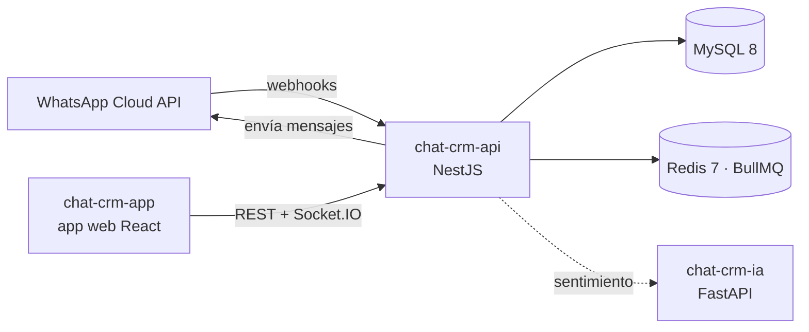

<picture>
  <source media="(prefers-color-scheme: dark)" srcset="https://raw.githubusercontent.com/chat-crm-suite/.github/main/brand/github/profile-banner-es-dark.svg">
  
</picture>

[English](README.md) · **Español**

**ChatCRM** es un CRM de código disponible construido alrededor de WhatsApp. Cada conversación con un cliente
llega a una bandeja compartida del equipo, se asigna al agente adecuado y se convierte en una ficha de
cliente que puedes medir, en tiempo real.

## Repositorios

| Repositorio | Qué es | Stack |
| --- | --- | --- |
| [**chat-crm-api**](https://github.com/chat-crm-suite/chat-crm-api) | Backend: integración con WhatsApp Cloud API, conversaciones, clientes, asignación, métricas y gateway en tiempo real | NestJS 11 · TypeORM · MySQL 8 · Redis 7 · BullMQ · Socket.IO · Zod |
| [**chat-crm-app**](https://github.com/chat-crm-suite/chat-crm-app) | Aplicación web: bandeja del equipo, contactos, usuarios, panel y asistente de configuración inicial | React 19 · Vite · TanStack Router y Query · Tailwind CSS 4 · shadcn/ui |
| [**chat-crm-ia**](https://github.com/chat-crm-suite/chat-crm-ia) | Servicio de IA opcional: análisis de sentimiento de los mensajes de clientes (español) | Python · FastAPI · pysentimiento |

## Cómo encaja todo

## Lo más destacado

- **Bandeja de WhatsApp compartida**: mensajes entrantes y salientes en tiempo real con Socket.IO.
- **Asignación automática**: las conversaciones se reparten entre los miembros disponibles del equipo.
- **Fichas de cliente**: cada número de teléfono corresponde a un cliente con todo su historial.
- **Métricas**: KPIs, tendencia mes a mes, desempeño de agentes y sentimiento de los clientes.
- **Seguro por defecto**: credenciales de canales cifradas en reposo (AES-256-GCM), webhooks firmados y token de configuración inicial.
- **Un contrato, dos apps**: esquemas Zod compartidos por la API y la app web; la documentación OpenAPI se genera a partir de ellos.

## Marca

Logos, íconos y reglas de uso en [`brand/`](https://github.com/chat-crm-suite/.github/tree/main/brand).

## Licencia

ChatCRM es de código disponible bajo la [PolyForm Noncommercial License 1.0.0](https://polyformproject.org/licenses/noncommercial/1.0.0).
El uso no comercial es gratuito. El uso comercial requiere una licencia comercial, **gratuita para
organizaciones con ingresos menores a USD 100.000 al año**. Consulta `COMMERCIAL.md` en cada repositorio.

Contacto: **chancanjeremiaron@gmail.com**

Las contribuciones son bienvenidas: lee la [guía de contribución](https://github.com/chat-crm-suite/.github/blob/main/CONTRIBUTING.md) y el [código de conducta](https://github.com/chat-crm-suite/.github/blob/main/CODE_OF_CONDUCT.md).
