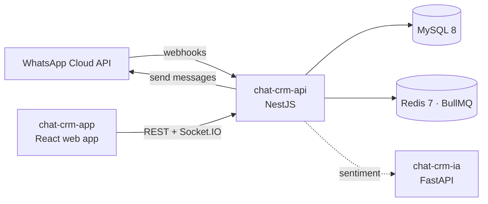

<picture>
  <source media="(prefers-color-scheme: dark)" srcset="https://raw.githubusercontent.com/chat-crm-suite/.github/main/brand/github/profile-banner-en-dark.svg">
  
</picture>

**English** · [Español](README.es.md)

**ChatCRM** is a source-available CRM built around WhatsApp. Every customer conversation lands in a shared team
inbox, is assigned to the right agent and becomes a customer record you can measure — in real time.

## Repositories

| Repository | What it is | Stack |
| --- | --- | --- |
| [**chat-crm-api**](https://github.com/chat-crm-suite/chat-crm-api) | Backend: WhatsApp Cloud API integration, conversations, customers, assignment, metrics, realtime gateway | NestJS 11 · TypeORM · MySQL 8 · Redis 7 · BullMQ · Socket.IO · Zod |
| [**chat-crm-app**](https://github.com/chat-crm-suite/chat-crm-app) | Web app: team inbox, contacts, users, dashboard and setup wizard | React 19 · Vite · TanStack Router & Query · Tailwind CSS 4 · shadcn/ui |
| [**chat-crm-ia**](https://github.com/chat-crm-suite/chat-crm-ia) | Optional AI service: sentiment analysis of customer messages (Spanish) | Python · FastAPI · pysentimiento |

## How it fits together

## Highlights

- **Shared WhatsApp inbox** — inbound and outbound messages in real time over Socket.IO.
- **Automatic assignment** — conversations are routed to available team members.
- **Customer records** — every phone number resolves to one customer with its full history.
- **Metrics** — KPIs, month-over-month trends, agent performance and customer sentiment.
- **Secure by default** — channel credentials encrypted at rest (AES-256-GCM), signed webhooks, first-run setup token.
- **One contract, two apps** — Zod schemas shared by the API and the web app; OpenAPI docs generated from them.

## Brand

Logos, icons and usage rules live in [`brand/`](https://github.com/chat-crm-suite/.github/tree/main/brand).

## License

ChatCRM is source-available under the [PolyForm Noncommercial License 1.0.0](https://polyformproject.org/licenses/noncommercial/1.0.0).
Noncommercial use is free. Commercial use needs a commercial license — **free for organizations under
USD 100,000/year in revenue**. See `COMMERCIAL.md` in each repository.

Contact: **chancanjeremiaron@gmail.com**

Contributions are welcome — read the [contributing guide](https://github.com/chat-crm-suite/.github/blob/main/CONTRIBUTING.md) and the [code of conduct](https://github.com/chat-crm-suite/.github/blob/main/CODE_OF_CONDUCT.md).
